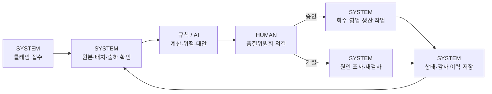

# Aurora QualityOps AI

> **Intelligent Quality & Supply Recovery Platform**
> 품질 이슈의 접수부터 사람의 승인, 회수와 공급 복구까지 연결하는 운영 시스템

삼일PwC **AX 인재전쟁 W03 — 품질 이슈와 공급 복구**를 위한 웹 애플리케이션입니다. 가상 화장품 제조사 **Corevia Cosmetics**의 원본 자료를 근거로 판단하고, 위원회의 결정에 따라 영업·생산·품질·물류 작업과 운영 상태를 실제 데이터베이스에 반영합니다.

**Python 3.9+ · Flask · SQLAlchemy · Pandas · SQLite · 한국어 UI**

| 실행 상태 | 분석 방식 | 검증 |
| :--- | :--- | :--- |
| 로컬 실행판 · Node 빌드 불필요 | 결정적 규칙 + 선택적 OpenAI 설명 | 자동 테스트 42개 통과 |

## 빠르게 시작하기

### Windows PowerShell

```powershell
git clone https://github.com/jeremypark9811/aurora-qualityops-ai.git
cd aurora-qualityops-ai

py -m venv .venv
.\.venv\Scripts\python.exe -m pip install -r requirements.txt
.\.venv\Scripts\python.exe -X utf8 app.py
```

브라우저에서 **http://127.0.0.1:5000**을 여세요.

이미 가상환경을 만든 현재 프로젝트에서는 마지막 실행 명령만 사용하면 됩니다. `py` 런처가 없다면 설치된 Python의 실행 경로로 가상환경을 생성하세요.

<details>
<summary>macOS / Linux</summary>

```bash
python3 -m venv .venv
.venv/bin/python -m pip install -r requirements.txt
.venv/bin/python app.py
```

자동 테스트는 Windows / Python 3.9.12에서 검증했습니다.

</details>

처음 실행하면 `instance/`에 로컬 DB와 세션키를 생성합니다. 접수·의결·작업 상태는 새로고침과 서버 재시작 후에도 유지됩니다. 실제 API 키 없이도 실행할 수 있습니다.

## 하나로 연결된 업무 흐름



- **확정 검사와 고객 주장을 구분합니다.** 신규 주장이나 언론 보도를 확정 불량 수량에 더하지 않습니다.
- **정책 계산은 규칙 엔진이 담당합니다.** 확정 수량 ÷ 배치 생산량을 계산하고 10% 기준을 검사합니다.
- **회수 결정은 사람이 내립니다.** 품질위원회 권한·사유·접수자와 다른 수행자를 확인합니다.
- **결정 이후 실제 작업이 생깁니다.** 부서 업무·공급 계획·배치 상태·감사 이력을 트랜잭션으로 저장합니다.
- **다음 판단은 이전 상태를 읽습니다.** 이미 승인된 배치를 중복 회수하지 않습니다.

## 주요 화면

| 화면 | 할 수 있는 일 |
| :--- | :--- |
| 품질 운영 개요 | 운영 KPI, 원본/신규 클레임 추이, 우선 확인 작업 |
| 원본 데이터 탐색 | 파일 검색, 컬럼·기간·품질·출처·관계 문서 확인 |
| 클레임 관리 / 배치 상세 | 원본 선택·접수·필터, 연결 배치와 과거 이력 조회 |
| AI 품질 분석 | 실제 수치, 불량률 계산, 규정, 대안과 미확인 정보 |
| 업무 타임라인 | SYSTEM / AI / HUMAN 여섯 단계와 실제 처리 기록 |
| 승인 센터 | 승인·거절·추가 정보 요청·보류 및 사유 기록 |
| 부서 작업 센터 | 영업·생산·물류·품질 작업, 모의 회신과 상태 변경 |
| 확장 분석 | 출하 추적 완전성과 반복 품질 이슈 경보 |
| 감사 로그 | 수행자·시각·변경 전후·근거·연결 작업 조회 |
| 시연 센터 | 정상·조건 변경·정보 부족·거절 상황 실행 |

### 직접 시연하기

1. **시연 센터**에서 접수 담당 역할로 정상 시나리오를 실행합니다.
2. **품질위원회** 역할로 바꾸고 접수자와 다른 이름을 입력합니다.
3. 타임라인에서 근거를 확인하고 사유를 적어 승인합니다.
4. **부서 작업 센터**에서 생성된 영업·생산 작업을 확인합니다.
5. 생산팀의 모의 회신으로 가용량을 입력해 부족량·고객 배분 변경을 확인합니다.

상단의 역할 전환은 **시연용 모의 권한**입니다. 실제 기업 인증이나 외부 시스템 처리를 뜻하지 않습니다. 자세한 순서는 [5분 시연 대본](docs/DEMO_SCRIPT.md)을 참고하세요.

## 두 가지 확장과 부서 연계

| 기능 | 실제 운영에 주는 영향 |
| :--- | :--- |
| 출하 추적 완전성 | 고객 식별·날짜·수량이 부족하면 범위 확정을 보류하고 물류 확인 작업 생성. 회신 후 재분석 |
| 반복 품질 이슈 경보 | 31일간 동일 제품·유형 3건 이상이면 품질 조사·추가 검사 작업 생성. 회수 자동 승인과 분리 |
| 영업 공급 복구 | 고객 안내·납품 협의 작업과 고객별 공급 배분·부족량 갱신 |
| 생산 재공급 검토 | 정상 재고·순가용량 확인, 부족 시 추가 생산 검토 작업과 영업 대안 갱신 |

반복 경보 임계값과 고객 배분 우선순위는 **시연 가정**으로 표시합니다. 원본 계약·승인 권한·생산 제약을 임의로 없애지 않습니다.

## 실제 데이터와 출처

과제에서 제공한 **가상 기업 데이터**입니다. 실제 고객·거래처 자료나 운영 비밀을 추가하지 마세요.

전체 원본은 **54개 파일(CSV 40개)**입니다. 여러 파일의 이름과 실제 내용이 달라 **실제 헤더와 본문으로 식별**합니다. CSV는 파이프(`|`)로 읽으며 원본을 수정하지 않습니다.

| 확인된 의미 | 실제 파일 | 행 수 |
| :--- | :--- | ---: |
| 생산 배치 | [sales_meeting_notes_cv (2).md](<04_원본데이터/sales_meeting_notes_cv (2).md>) | 480 |
| 품질 클레임·확정 검사 | [fin_ap_aging_ms (2).csv](<04_원본데이터/fin_ap_aging_ms (2).csv>) | 165 |
| 배치 출하 추적 | [fin_cash_daily_ms (2).csv](<04_원본데이터/fin_cash_daily_ms (2).csv>) | 1,431 |
| 품질 정책 | [fin_ar_aging_ms (2).csv](<04_원본데이터/fin_ar_aging_ms (2).csv>) | 문서 |
| 불량률 계산 정의 | [id_conventions (2).md](<04_원본데이터/id_conventions (2).md>) | 문서 |
| 승인 권한 | [calculation_definitions (2).md](<04_원본데이터/calculation_definitions (2).md>) | 문서 |

예: `B-02-2602-01`은 **확정 불량 17,900 / 생산 150,745 ≈ 11.87%**입니다. 회수 요건 판정과 위원회의 실행 의결을 분리합니다.

[데이터 사전](docs/DATA_DICTIONARY.md) · [관계·조인 검증](docs/DATA_RELATIONSHIPS.md) · [품질 검사](docs/DATA_QUALITY.md) · [원본과 가정](docs/ASSUMPTIONS.md) · [지표 계보](docs/DATA_LINEAGE.md)

프로파일과 관계 문서를 다시 생성하려면:

```powershell
.\.venv\Scripts\python.exe -X utf8 -m scripts.write_docs
.\.venv\Scripts\python.exe -X utf8 -m scripts.profile_data
```

## 선택적 OpenAI 연동

[.env.example](.env.example)을 참고해 프로젝트 루트의 `.env`에 설정합니다. 기존 `.env`가 있다면 덮어쓰지 마세요.

```dotenv
OPENAI_API_KEY=
OPENAI_MODEL=gpt-4.1-mini
HOST=127.0.0.1
PORT=5000
```

- 키가 없으면 **규칙 기반 분석**이라고 표시합니다.
- 키가 있으면 최소 수치와 제한된 설명만 전달하고 구조화 JSON 응답을 검증합니다.
- AI는 위험 요약·대안 설명을 보조하며, 숫자·정책·승인 권한을 변경하지 않습니다.
- 호출 실패·형식 오류는 규칙 기반으로 전환합니다. 실제 키를 사용한 성공 호출은 검증하지 않았습니다.

## 테스트와 시연 초기화

```powershell
.\.venv\Scripts\python.exe -X utf8 -m pytest tests -q
```

**42개 자동 테스트**로 정상 처리, 조건 변경, 정보 부족 회신, 승인 거절, 계산 경계, 권한, 동시·중복 의결, DB 지속성과 원본 불변성을 검증했습니다. [검증 기록](docs/TEST_RESULTS.md)에 브라우저 확인 범위도 정리했습니다.

시연 데이터는 **품질팀 → 시연 센터 → 시연 데이터 초기화**에서 정리할 수 있습니다. 원본·실제 운영 접수·감사 이력은 보존하며, 같은 배치에 실제 운영 접수가 있으면 초기화를 막습니다.

독립된 시연 DB를 사용하려면:

```powershell
$env:QUALITYOPS_DATABASE_URL='sqlite:///instance/separate-demo.db'
.\.venv\Scripts\python.exe -X utf8 app.py
```

## 프로젝트 구조

```text
aurora-qualityops-ai/
├── app.py                  # Flask 앱·REST API·서버 진입점
├── qualityops/              # 원본 식별·모델·규칙·AI 보조
├── templates/               # Jinja 화면
├── static/                  # CSS·JavaScript
├── tests/                   # 자동 테스트
├── scripts/                 # 프로파일·문서·저장소 점검
├── docs/                    # 설계·데이터·시연·검증 문서
├── 04_원본데이터/            # 제공된 원본 자료, 읽기 전용 사용
├── requirements.txt
├── .env.example             # 값 없는 설정 예시
└── instance/                # 로컬 DB·세션키, Git 제외
```

Python 앱과 관계없는 이전 Next.js 템플릿·의존성·빌드 파일은 정리했습니다. 협업 지침과 Axhub 참고 문서는 보존했습니다. 기존 Axhub 원격은 로컬 Git 설정에 남아 있으며, GitHub 업로드와 Axhub 재배포는 별개입니다.

## 저장소에 포함하지 않는 것

`.gitignore`는 실제 환경변수, 로컬 DB·세션키, 인증 파일·개인키, AI 도구의 비공개 설정·세션 기록, 가상환경·캐시·로그를 제외합니다. 설정 이름만 있는 `.env.example`은 포함합니다.

업로드 전에 다음을 실행하세요. 점검기는 알려진 비밀값 패턴과 제외 규칙을 검사하며 **발견한 값 자체는 출력하지 않습니다**.

```powershell
powershell -ExecutionPolicy Bypass -File scripts/check_repository.ps1
```

이미 Git 이력에 들어간 비밀값은 ignore 규칙만으로 지워지지 않습니다. 실제 키가 유출된 경우에는 키 폐기·재발급과 이력 정리가 필요합니다.

## 문서와 제출 준비

| 문서 | 내용 |
| :--- | :--- |
| [시스템 구조](docs/ARCHITECTURE.md) | 데이터 흐름·트랜잭션·AI와 사람의 경계 |
| [업무 흐름](docs/WORKFLOW.md) | 승인 권한·상태·회신·종료 조건 |
| [확장 기능](docs/EXTENSIONS.md) | 추적 완전성과 반복 이슈 탐지 |
| [부서 영향](docs/CROSS_DEPARTMENT.md) | 영업·생산의 계획·작업 변화 |
| [5분 시연 대본](docs/DEMO_SCRIPT.md) | 화면별 클릭 순서와 설명 |
| [제출 초안](docs/SUBMISSION_NOTES.md) | 구현 범위·가정·설계 설명 초안 |

### 현재의 한계

- **로컬 실행판**입니다. 원격 지속 운영에는 PostgreSQL·실제 인증·마이그레이션이 필요합니다.
- 제조 정상 재고·납기일·일별 생산 일정·생산능력 기간 단위는 원본에서 부족해 확인 대상으로 남겼습니다.
- SBL 배치 출하와 SH 주문 출하의 ID가 연결되지 않아 주문·납기를 임의 귀속하지 않습니다.
- 외부 이메일·ERP·실물 회수는 모의이며 내부 DB 처리만 실제입니다.
- A04 원문과 실제 제출 6문항 제목은 미확인입니다. 제출 초안은 실제 양식과 대조해야 합니다.
- 실제 AI 성공 호출, 영상 촬영, 대회 제출, Python 앱의 원격 배포는 미수행입니다.

[공식 과제 페이지](https://axacademy.ai/axwar/samilpwc-1)
