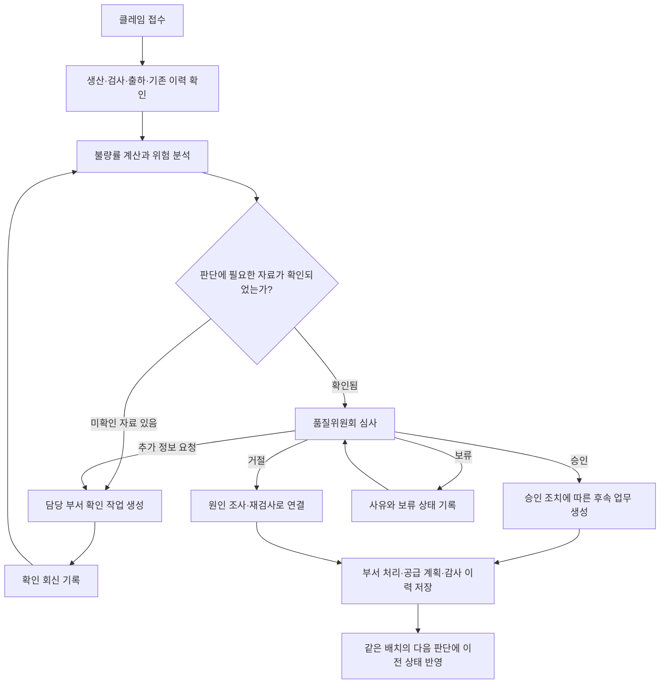
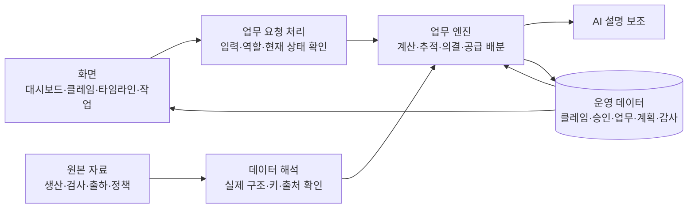

# Aurora QualityOps AI

> **Intelligent Quality & Supply Recovery Platform**
>
> 품질 이슈의 발견부터 판단, 사람의 승인, 고객 공급 복구까지 연결하는 운영 애플리케이션

**Aurora QualityOps AI**는 가상 화장품 제조사 **Corevia Cosmetics**의 품질 문제를 생산 배치 단위로 관리하는 웹 애플리케이션입니다. 고객 클레임을 실제 생산·검사·출하 자료와 연결하고, 품질위원회의 결정에 따라 영업·생산·물류·품질팀의 후속 업무를 생성합니다.

하나의 품질 이슈가 **어떤 데이터로 판단되었는지**, **누가 어떤 이유로 결정했는지**, **결정 이후 어느 부서가 무엇을 해야 하는지**를 같은 화면 흐름에서 추적할 수 있습니다.

## 설치 및 실행

Python이 설치된 환경에서 실행할 수 있습니다. 현재 검증한 환경은 **Windows / Python 3.9.12**입니다. 저장소를 내려받을 때 앱에서 사용하는 `04_원본데이터/` 폴더도 함께 보관하세요.

### 처음 설치하는 경우 · Windows PowerShell

```powershell
git clone https://github.com/jeremypark9811/aurora-qualityops-ai.git
cd aurora-qualityops-ai

py -m venv .venv
.\.venv\Scripts\python.exe -m pip install -r requirements.txt
.\.venv\Scripts\python.exe -X utf8 app.py
```

Git을 사용하지 않는다면 GitHub의 **Code → Download ZIP**으로 내려받아 압축을 풀고, 해당 폴더에서 가상환경 생성 명령부터 실행하면 됩니다. `py` 명령을 사용할 수 없다면 설치된 Python의 `python` 명령이나 실행 파일 경로를 사용하세요.

실행 후 브라우저에서 **http://127.0.0.1:5000**에 접속합니다. 처음 실행하면 로컬 데이터베이스와 세션키가 자동 생성되므로 별도 DB 초기화는 필요하지 않습니다. AI 연결 설정이 없어도 **규칙 기반 분석**으로 사용할 수 있습니다.

### 설치 후 다시 실행하는 경우

프로젝트 폴더에서 다음 명령만 실행합니다.

```powershell
.\.venv\Scripts\python.exe -X utf8 app.py
```

서버를 종료하려면 실행한 터미널에서 **Ctrl+C**를 누릅니다. 이미 서버가 실행 중이라면 다시 실행하지 않고 접속 주소를 열면 됩니다. 종료 후 다시 실행해도 저장된 클레임·승인·부서 작업 상태는 유지됩니다.

### macOS / Linux

```bash
git clone https://github.com/jeremypark9811/aurora-qualityops-ai.git
cd aurora-qualityops-ai
python3 -m venv .venv
.venv/bin/python -m pip install -r requirements.txt
.venv/bin/python app.py
```

접속 주소는 동일합니다. macOS / Linux의 실행 명령은 안내용이며, 실제 동작 검증은 앞서 명시한 Windows 환경에서 진행했습니다.

## 어떤 업무를 해결하나요?

품질 문제가 발생하면 담당자는 불량 여부와 영향 범위를 확인하는 동시에 고객 안내, 회수 심사, 대체 공급, 생산 일정 검토를 함께 진행해야 합니다. 부서마다 다른 자료와 판단 기준을 사용하면 같은 배치를 두고도 대응이 달라지거나, 의결 이후 실제 후속 처리가 누락될 수 있습니다.

이 앱은 다음 정보를 연결합니다.

| 관리 대상 | 확인하는 질문 |
| :--- | :--- |
| 고객 클레임 | 누가 어떤 제품과 배치에 대해 문제를 제기했는가? |
| 생산·검사 자료 | 얼마나 생산했고, 검사로 확정된 불량은 얼마인가? |
| 출하 추적 | 해당 배치가 어느 고객에게 얼마나 출하되었는가? |
| 품질 의결 | 적용 규정은 무엇이며, 위원회는 어떤 조치를 결정했는가? |
| 공급 복구 | 고객 안내와 재공급에 필요한 다음 작업은 무엇인가? |
| 처리 이력 | 이전에 같은 배치를 어떻게 처리했고, 지금 무엇이 달라졌는가? |

품질팀은 판단 근거와 원인 조사를, 위원회는 의결을, 영업팀은 고객 대응을, 생산팀은 재공급 가능성을, 물류팀은 출하 범위 확인을 담당합니다.

## 전체 작동 방식



### 1. 클레임을 접수합니다

접수 담당자가 원본 자료에서 고객사·제품·생산 배치를 선택하고, 클레임 유형·발생일·내용·증빙 여부를 입력합니다. 앱은 배치 존재 여부, 배치와 제품의 일치 여부, 날짜와 필수 입력을 검사한 뒤 새로운 접수 기록을 만듭니다.

이때 입력한 내용은 **고객의 주장**으로 저장합니다. 접수만으로 해당 수량을 검사 확정 불량으로 처리하지 않습니다.

### 2. 배치와 관련 자료를 조회합니다

선택한 배치의 생산 수량, 품질 검사, 누적 클레임, 고객별 출하 기록과 기존 회수 상태를 조회합니다. 분석에 사용한 자료에는 원본 파일명과 레코드 식별자가 함께 남습니다.

기존에 회수가 승인된 배치라면 그 승인 이력을 먼저 읽고, 새로운 접수를 기존 처리에 연결합니다. 같은 배치에 대해 회수 절차를 중복 생성하지 않도록 합니다.

### 3. 규칙에 따라 계산하고 대응 대안을 정리합니다

불량률은 다음과 같이 계산합니다.

```text
배치 불량률 = 검사로 확정된 불량 수량 합계 ÷ 배치 생산 수량 × 100
```

적용 정책은 **규격 이탈이 확정되고 배치 불량률이 10% 이상이면 회수 심사 대상**으로 판단하는 것입니다. 실제 회수 절차의 개시는 품질위원회의 의결을 거칩니다. 원인 조사는 별도의 업무로 진행합니다.

예를 들어 `B-02-2602-01`은 다음 원본 수치로 계산됩니다.

| 항목 | 수치 |
| :--- | ---: |
| 배치 생산 수량 | 150,745개 |
| 확정 불량 수량 | 17,900개 |
| 확정 불량률 | 약 11.87% |

생산 수량이 없거나 0인 경우, 확정 검사 수량이 확인되지 않은 경우에는 불량률을 확정하지 않습니다. 미확정 클레임과 언론 보도도 확정 불량 수량에 더하지 않습니다.

### 4. 사람이 승인 여부를 결정합니다

품질위원회는 원본 수치, 규정, 분석 설명, 대응 대안, 고객 영향과 미확인 정보를 검토합니다. **승인·거절·추가 정보 요청·보류** 중 하나를 선택하고 사유를 기록합니다.

접수자와 승인자는 구분하며, 이미 결정된 요청에 같은 결정을 반복 적용하는 것을 막습니다. 재분석으로 자료가 바뀌면 미결 요청을 새 분석에 연결된 요청으로 대체하고 이전 기록은 남깁니다.

### 5. 결정에 따라 실제 업무를 만듭니다

회수가 승인되면 배치 상태를 회수 진행으로 바꾸고, 고객 안내·납품 협의·재공급 검토·원인 조사 등의 작업을 생성합니다. 위원회가 거절하면 회수 조치를 개시하지 않고 조사 또는 재검사 작업으로 연결합니다.

정보가 부족한 경우에는 확인할 부서와 내용이 지정된 작업을 만들고, 회신이 들어오면 그 정보를 기록해 다시 판단합니다.

### 6. 변경된 상태를 저장하고 다음 판단에 사용합니다

클레임 상태, 위원회 의결, 부서 작업, 재공급 계획과 감사 이력을 데이터베이스에 저장합니다. 화면을 새로고침하거나 서버를 재시작해도 운영 상태가 유지됩니다.

다음 클레임이나 추가 정보가 들어오면 저장된 상태를 다시 읽어 기존 회수와 중복되는지, 조사 우선순위를 바꿔야 하는지, 재심사가 필요한지를 확인합니다.

## 화면 구성과 각 섹션의 역할

### 01. 품질 운영 개요

현재 품질 업무의 규모와 우선순위를 확인하는 시작 화면입니다.

- 전체 신규 클레임, 승인 대기, 정보 확인 필요, 회수 진행 배치, 처리 완료, 후속 작업 수를 표시합니다.
- 원본 품질 기록과 앱에서 새로 접수한 기록을 구분해 월별 추이를 보여줍니다.
- 최근 접수 목록과 우선 확인할 작업에서 관련 업무로 이동할 수 있습니다.

원본에 포함된 검사·클레임 기록과 앱의 신규 운영 접수는 서로 다른 모집단으로 표시합니다. 예를 들어 원본 165건을 신규 접수 건수로 중복 계산하지 않습니다.

### 02. 원본 데이터 탐색기

앱이 사용하는 자료의 정체와 품질을 확인하는 화면입니다. 파일명·부서·컬럼으로 검색하고, 각 자료의 행 수·컬럼·자료형·날짜 범위·결측·중복 여부와 활용 목적을 볼 수 있습니다.

이 프로젝트의 원본 중에는 **파일명과 실제 내용이 다른 자료**가 있습니다. 따라서 파일 이름으로 의미를 추정하지 않고 실제 헤더와 본문으로 생산·검사·출하·정책 자료를 구분합니다.

데이터 사전, 조인 검증, 데이터 품질, 가정과 지표 계보 문서도 이 화면에서 열 수 있습니다. 사용자는 지표가 어느 자료의 어떤 컬럼에서 나왔는지 확인할 수 있습니다.

### 03. 클레임 관리와 배치 상세

새로운 품질 이슈를 등록하고 현재 처리 상태를 추적하는 화면입니다.

클레임 목록은 상태·제품·고객사·생산 배치·발생 기간·위험 수준으로 조회합니다. 상세 화면에는 접수 내용, 분석 결과, 승인 기록, 관련 작업과 재공급 계획이 연결됩니다.

배치 코드를 누르면 **배치 추적 화면**으로 이동합니다. 이곳에서는 원본 생산 기록, 해당 배치에 연결된 운영 클레임, 검사·출하 근거와 추가 확인이 필요한 범위를 함께 볼 수 있습니다.

### 04. AI 품질 분석

해당 클레임을 어떤 근거로 판단했는지 설명하는 화면입니다.

| 구역 | 보여주는 내용 |
| :--- | :--- |
| 원본 사실 | 배치 생산량, 확정 검사 수량, 고객별 출하 수량 |
| 규칙 계산 | 불량률 산식, 적용 임계값과 회수 요건 판정 |
| 분석 설명 | 위험 요인, 대응 대안, 후속 작업 초안 |
| 미확인 정보 | 부족한 검사·출하 자료와 충돌 항목 |
| 원본과 가정 | 원본 자료, 시연 이벤트와 확인 회신의 구분 |
| 근거 데이터 | 사용한 파일명, 레코드 식별자와 실제 값 |

추가 정보가 들어와 재분석하면 **이전 분석과 최근 분석을 비교**할 수 있습니다. 수치가 달라졌는지뿐 아니라, 입력이 바뀌어도 왜 기존 판단이 유지되는지 확인할 수 있습니다.

### 05. 업무 타임라인

한 클레임의 처리 과정을 세로 흐름으로 확인하는 화면입니다.

| 단계 | 역할 | 확인할 수 있는 내용 |
| :--- | :--- | :--- |
| 처리할 일 접수 | SYSTEM | 고객·배치·접수 내용과 담당자 |
| 관련 데이터 확인 | SYSTEM | 조회한 자료 수와 미확인 정보 |
| 계산과 판단 | AI / 규칙 | 실제 계산, 분석 모드와 판정 근거 |
| 품질위원회 승인 | HUMAN | 의결 상태, 사유와 승인·거절 동작 |
| 부서별 후속 처리 | SYSTEM | 생성된 부서 작업과 진행 상태 |
| 상태 기록과 다음 판단 | SYSTEM | 배치 상태, 회수 승인 여부와 변경 이력 |

각 단계를 펼쳐 결과와 처리 시각을 확인합니다. 의결이 이루어지면 후속 작업과 상태가 화면에 반영되며, 이전 배치 승인을 참조하는 경우에는 기존 의결 이력임을 표시합니다.

### 06. 품질위원회 승인 센터

위원회가 심사할 요청과 과거 의결을 모아 보는 화면입니다.

요청별로 배치·고객·제품, 확정 불량률, 영향 출하량, 추적 완전성, 적용 정책과 분석 설명을 제공합니다. 담당자는 사유를 작성해 승인·거절·보류·추가 정보 요청을 처리합니다.

회수 승인 직전에는 최신 자료를 다시 확인합니다. 심사 자료 이후 수치가 달라졌거나 실행에 필요한 정보가 부족하면 재분석을 요구하고, 동일 배치가 이미 승인되었으면 중복 회수를 차단합니다.

### 07. 부서별 작업 센터

판단 이후 실제로 수행할 일을 부서별로 처리하는 화면입니다. **영업팀·생산팀·물류팀·품질팀** 탭으로 나뉘며, 작업의 생성 이유·관련 클레임·배치·우선순위·상태를 확인합니다.

| 부서 | 작업과 회신의 역할 |
| :--- | :--- |
| 영업팀 | 고객 안내, 납품 일정 재검토, 대체 공급 협의와 고객별 공급 배분 |
| 생산팀 | 정상 재고와 순가용 생산량 확인, 재공급 및 생산 일정 재검토 |
| 물류팀 | 출하 기록별 고객사 연결·수량·날짜 확인 |
| 품질팀 | 원인 조사, 재검사, 추가 정보 확인과 반복 이슈 조사 |

작업은 진행·보류·완료로 변경하고 처리 사유를 남깁니다. 물류 확인 회신은 실제 출하 기록과 원본 고객에 맞아야 하며, 없는 출하를 생성하거나 알려진 고객을 임의로 바꿀 수 없습니다.

생산팀이 정상 재고와 기존 납품 약속을 차감한 순가용 생산량을 회신하면 **재공급 부족량과 고객별 배분안**을 다시 계산합니다. 부족이 남으면 추가 생산 검토 업무가 생성되고 영업팀의 협의 자료도 갱신됩니다.

### 08. 확장 분석

출하 정보의 신뢰성과 품질 문제의 반복성을 운영 판단에 반영하는 화면입니다.

**출하 추적 완전성**은 해당 배치의 기록된 출하 수량 중 고객이 유효하게 식별된 수량의 비율입니다. 고객 연결이 부족하면 범위 확정을 보류하고 물류 확인 작업을 생성합니다. 날짜·수량 충돌은 비율과 별도로 검사하므로 비율이 100%여도 충돌이 있으면 실행을 보류합니다.

**반복 품질 이슈 조기 경보**는 최근 31일의 동일 제품·동일 유형 접수를 집계하고 직전 기간, 고객별·배치별 분포를 함께 확인합니다. 3건 이상이면 품질 조사·추가 검사 작업을 생성합니다. 이 기준은 시연용 경보 정책이며, 반복 클레임만으로 확정 불량이나 회수 승인을 선언하지 않습니다.

### 09. 감사 로그

누가 언제 어떤 근거로 판단하고 무엇을 변경했는지 확인하는 화면입니다.

클레임 접수, 분석, 의결, 업무 생성, 담당 부서 회신과 상태 변경을 시간순으로 저장합니다. 기록에는 수행자, 변경 전후 상태, 사유, 근거 자료와 연결 작업 번호가 포함됩니다. 클레임 번호로 관련 이력을 모아 볼 수 있습니다.

역할 전환과 시연 초기화도 기록에 남기며, 시연 데이터를 초기화해도 감사 이력은 보존합니다.

### 10. 시연 센터

실제 업무 로직을 사용해 대표 상황을 경험하는 화면입니다.

| 시나리오 | 작동 흐름 |
| :--- | :--- |
| 정상 처리 | 실제 배치에 신규 클레임 접수 → 분석 → 위원회 의결 → 부서 작업과 상태 변경 |
| 조건 변경 | 언론 보도 이벤트 추가 → 재분석 → 전후 비교 → 판단 유지 근거와 조사 우선순위 반영 |
| 정보 부족 | 출하 고객 확인 보류 → 물류 작업 생성 → 확인 회신 → 재분석과 승인 요청 |
| 승인 거절 | 회수 제안에 대한 거절과 사유 기록 → 회수 미실행 → 원인 조사·재검사 |

시나리오 실행은 접수·분석·요청 생성까지 이어집니다. **위원회 의결과 담당 부서 회신은 사용자가 직접 처리**합니다.

시연용 입력은 원본 사실과 구분하여 저장합니다. 초기화는 시연 클레임과 파생 자료에만 적용하고 원본과 감사 이력을 보존합니다. 같은 배치에 실제 운영 접수가 연결되어 있으면 초기화를 차단합니다.

## 사용자 역할과 의사결정 경계

화면 상단의 **시연용 역할 전환**에서 수행할 부서와 담당자 이름을 선택합니다. 현재의 역할 전환은 모의 권한이며 실제 기업 계정 인증을 의미하지 않습니다.

| 역할 | 담당하는 의사결정과 작업 |
| :--- | :--- |
| 접수 담당 | 클레임 등록, 분석 실행, 추가 정보 입력 |
| 품질위원회 | 승인·거절·추가 정보 요청·보류 의결 |
| 영업팀 | 고객 대응 작업, 공급 우선순위와 협의 상태 관리 |
| 생산팀 | 재공급 작업, 정상 재고와 순가용 여력 확인 |
| 물류팀 | 출하 고객사와 추적 자료 확인 회신 |
| 품질팀 | 조사·추가 검사 회신·재분석, 종료 조건 확인과 시연 초기화 |

접수자와 승인자의 이름을 구분하고, 부서 작업은 해당 부서 역할에서 처리하도록 합니다. 품질위원회가 거절한 회수를 시스템이 대신 실행하지 않습니다.

## 규칙 엔진과 AI의 역할

두 구성 요소는 서로 다른 책임을 가집니다.

| 구성 요소 | 담당하는 일 |
| :--- | :--- |
| 규칙 엔진 | 수량 계산, 정책 비교, 식별자·날짜 검증, 실행 요건과 상태 전이 검사 |
| AI 설명 보조 | 데이터 의미 해석, 위험 요약, 대안 비교 설명과 부서 작업 초안 |
| 사람 | 품질위원회 의결, 담당 부서 확인 회신과 처리 사유 입력 |

AI 연결이 없는 경우에는 **규칙 기반 분석**으로 작동하며 화면에 해당 모드를 표시합니다. AI가 연결되어도 응답 구조를 검증하고 설명 보조로만 사용합니다. 호출이나 응답 검증에 실패하면 규칙 기반 설명으로 전환합니다.

검사 수치와 최종 실행 요건은 AI가 임의로 변경할 수 없습니다. 언론 보도는 사실 확인과 조사 우선순위에 영향을 줄 수 있지만 확정 불량 수량으로 합산하지 않습니다.

## 공급 복구 계획은 어떻게 달라지나요?

회수 의결 이후 앱은 기록된 출하 수량을 기준으로 필요한 재공급량을 계획합니다. 이때 기록된 출하 전체를 교체 요청 범위로 사용하는 보수적 계획 가정을 표시합니다.

```text
공급 가능량 = 확인된 정상 재고 + 기존 고객 약속을 차감한 순가용 생산량
공급 부족량 = max(재공급 필요량 - 공급 가능량, 0)
```

확인 회신 전에는 재고·여력·부족량을 확정하지 않고 **생산 여력 확인 필요**로 남깁니다. 생산 회신에는 적용 기간과 기존 고객 약속 보호 여부가 포함되어야 합니다.

예를 들어 필요한 물량이 **145,860개**이고 정상 재고 **100개**, 순가용 생산량 **200개**가 모의 회신되면 부족량은 **145,560개**입니다. 이 결과는 추가 생산 검토 업무와 영업팀의 고객별 공급 협의 자료에 반영됩니다.

고객별 배분은 출하 수량 우선 또는 고객 코드 순으로 조정할 수 있습니다. 이 우선순위는 원본 계약에서 확인된 납기 순위가 아닌 **별도로 표시하는 시연 정책**입니다. 원본에 없는 정상 재고·납기·생산 일정을 확정값으로 만들지 않습니다.

## 상태와 이력의 구조

클레임, 배치, 부서 작업과 공급 계획은 각각 다른 상태를 갖습니다.

| 대상 | 상태를 나누는 이유 |
| :--- | :--- |
| 클레임 | 접수·분석·정보 확인·심사·조사·종료까지 개별 사건의 진행을 추적 |
| 생산 배치 | 같은 배치에 여러 클레임이 들어와도 회수 승인과 출하 보류를 일관되게 관리 |
| 승인 요청 | 분석 버전별 심사와 의결을 보존하고, 대체된 요청과 중복 결정을 구분 |
| 부서 작업 | 담당 부서별 진행·보류·완료와 확인 회신을 관리 |
| 재공급 계획 | 여력 미확인·공급 부족·계획 검토 가능을 구분 |
| 감사 이력 | 각 변경의 수행자·시각·이유·근거를 보존 |

대표적인 클레임 흐름은 다음과 같습니다.

```text
신규 접수 → 데이터 확인 중 → 분석 완료 → 승인 대기 → 회수 진행 / 원인 조사 → 처리 완료
                    └→ 정보 확인 필요 → 확인 회신 → 재분석
```

의결과 후속 업무 생성은 하나의 저장 단위로 처리합니다. 중복 클릭이나 동시 의결로 같은 작업이 여러 번 생성되는 것을 막습니다. 처리 완료는 품질팀이 확인하며, 배치에 미완료 작업이 남거나 재공급 여력이 미확인·부족 상태이면 종료할 수 없습니다.

## 앱의 내부 구조



| 계층 | 역할 | 구현 위치 |
| :--- | :--- | :--- |
| 화면 | 메뉴, 입력 폼, 타임라인과 작업 상태 표시 | [화면 틀](templates/index.html), [화면 동작](static/qualityops.js), [디자인](static/qualityops.css) |
| 업무 요청 처리 | 입력·역할 검증, 조회와 변경 요청, 저장 경계 관리 | [app.py](app.py) |
| 원본 자료 해석 | 실제 컬럼 구조, 인코딩, 자료 품질과 출처 식별 | [catalog.py](qualityops/catalog.py) |
| 업무 판단·처리 | 불량률, 추적 완전성, 반복 경보, 의결과 부서 작업 연결 | [service.py](qualityops/service.py) |
| AI 설명 | 필요한 근거에 한정한 설명과 응답 검증 | [ai.py](qualityops/ai.py) |
| 저장 모델 | 원본 스냅샷과 운영 자료, 상태·이력의 구분 | [models.py](qualityops/models.py) |

원본 자료는 읽기 전용으로 사용합니다. 실제 파일 내용과 식별자를 확인해 연결하고, 앱에서 생성한 클레임·분석·의결·회신은 별도 운영 자료로 저장합니다.

전체 원본은 **54개 파일**, 그중 CSV 확장자는 **40개**입니다. 주요 연결 대상은 생산 배치 **480건**, 원본 검사·클레임 **165건**, 배치 출하 추적 **1,431건**입니다.

배치 출하 표와 주문별 출하 표의 식별자가 직접 연결되지 않는 부분은 **연결 미확인**으로 남깁니다. 고객이나 제품이 같다는 이유만으로 특정 주문을 배치에 임의 연결하지 않으며, 이런 데이터 공백도 분석과 부서 확인 업무에 반영합니다.
