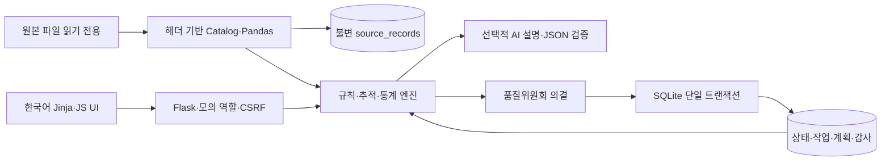

# 시스템 구조

- `app.py`: 앱 팩토리, API, 세션·입력 검증, 트랜잭션 경계, Waitress.
- `qualityops/catalog.py`: 실제 본문 식별, 인코딩·파이프 검증, SHA256·통계·사전.
- `qualityops/models.py`: SQLAlchemy 모델, SQLite FK/WAL, 원본 UPDATE/DELETE 방지 트리거.
- `qualityops/service.py`: Decimal 계산, 출하 추적, 반복 경보, 의결, 부서 작업·공급 배분.
- `qualityops/ai.py`: 최소 정보·정형 JSON 검증·실패 폴백. 상태 변경 권한 없음.
- `templates/`, `static/`: 독립적인 Flask UI. Node 빌드 불필요.
- `scripts/write_docs.py`, `tests/test_operations.py`: 실제 프로파일·관계 문서와 테스트.

원본 스냅샷은 파일·행 번호·해시·JSON, 운영 자료는 claims/analyses/approvals/batch_states/department_tasks/evidence/recovery_plans/audit_logs/settings로 분리한다. 채택한 원본 테이블만 DB에 적재하며 전체 파일 프로파일은 catalog.json에 보존한다. 파일 해시 변경은 묵시적 덮어쓰기 대신 시작 오류로 처리한다.

상태 변경은 BEGIN IMMEDIATE로 읽기·검사·쓰기 전체를 직렬화한다. 의결·배치 상태·업무·계획·감사는 함께 커밋하고 오류 시 롤백한다. 동시 의결은 하나만 성공, 나머지는 409. 업무 유일 키와 기존 배치 승인 상태로 중복 실행을 막는다.

역할은 서버 세션에서 확인하고 접수·승인 이름을 분리한다. 공개된 모의 역할 전환이므로 실인증이 아니다. POST CSRF, JSON 크기·필드 검증, DOM escaping을 사용한다. 원격 실운영에는 실인증·PostgreSQL·마이그레이션이 필요하며 이번 Python 앱은 로컬판이다.
